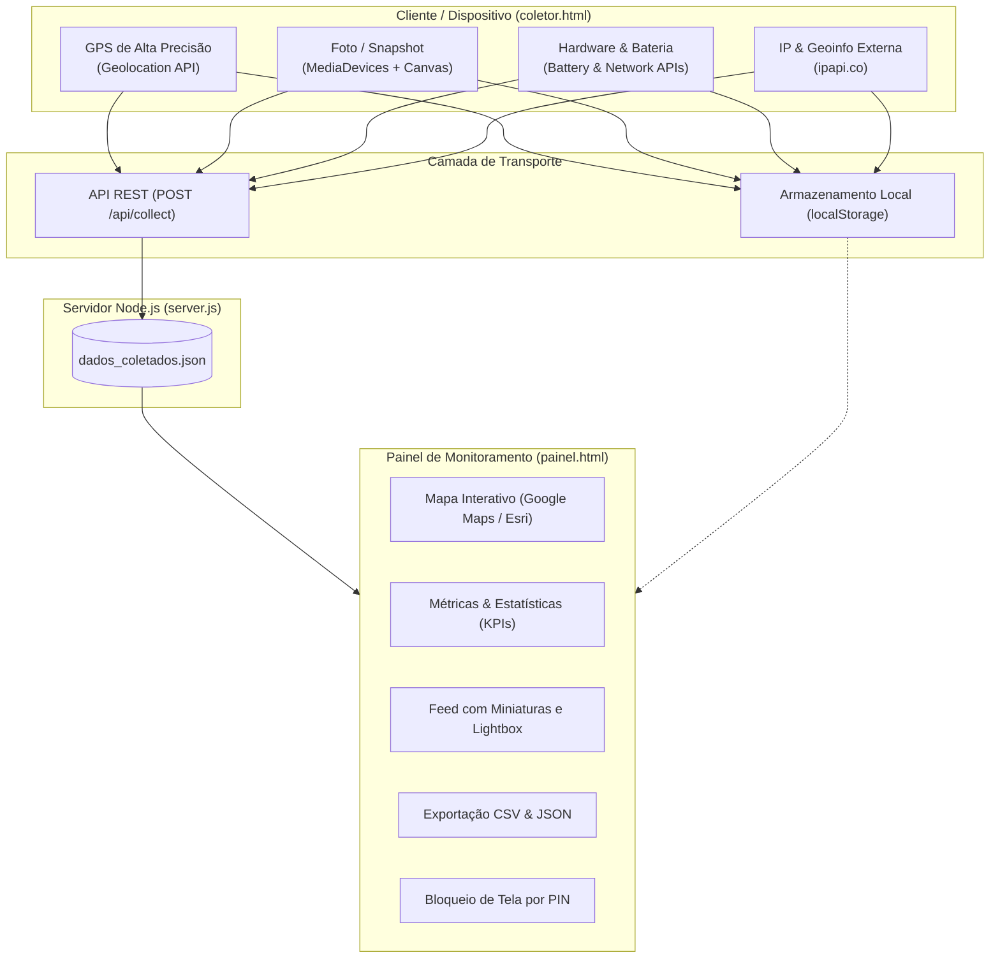

# 🛰️ web-telemetry-dashboard

[](https://developer.mozilla.org/pt-BR/docs/Web/JavaScript)
[](https://nodejs.org/)
[](https://leafletjs.com/)
[](LICENSE)

> Painel de telemetria de hardware, diagnóstico de dispositivos e monitoramento geográfico em tempo real com captura de alta precisão via Web APIs e visualização cartográfica interativa multicamadas com Leaflet, Google Maps e Esri.

---

## 📋 Índice

* [Visão Geral](#-visão-geral)
* [Funcionalidades Principais](#-funcionalidades-principais)
* [Arquitetura & Fluxo](#-arquitetura--fluxo)
* [Tecnologias Utilizadas](#-tecnologias-utilizadas)
* [Estrutura de Arquivos](#-estrutura-de-arquivos)
* [Como Executar](#-como-executar)
  * [Modo Rede Local (Cross-Device)](#modo-rede-local-cross-device-celular--computador)
  * [Modo Standalone (Sem Servidor)](#modo-standalone-sem-servidor)
* [Segurança, Ética e Privacidade (LGPD / GDPR)](#-segurança-ética-e-privacidade)
* [Licença](#-licença)

---

## 🎯 Visão Geral

O **`web-telemetry-dashboard`** é uma prova de conceito (PoC) moderna e completa desenvolvida para demonstrar o poder das **Web APIs contemporâneas** sem dependência de frameworks pesados no cliente. 

O projeto opera em um modelo cliente-servidor leve e híbrido:
1. Uma ponta de auditoria/coleta (`coletor.html`) que solicita permissões ao usuário para obter parâmetros físicos de satélite, dados de carga, conectividade de rede e teste do sensor de câmera.
2. Um centro de monitoramento administrativo (`painel.html`) que consome e compila essas métricas em tempo real, plotando localizações no mapa interativo e organizando relatórios executivos.

---

## 🌟 Funcionalidades Principais

### 1. 📍 Geolocalização de Alta Precisão (GPS)
* Coleta de coordenadas precisas via `navigator.geolocation` (`latitude`, `longitude`, `altitude`, `velocidade` e margem de erro `accuracy`).
* Traçado de raio de acurácia em metros no mapa cartográfico.

### 2. 🗺️ Mapa Interativo Multicamadas (Sem Limites de API)
* **Google Maps Ruas**: Detalhamento urbano rico, com avenidas, bairros e pontos de interesse em português.
* **Google Maps Satélite / Híbrido**: Imagens aéreas reais com overlay dos nomes das vias.
* **Esri World Street Map**: Cartografia global limpa para visualização analítica.
* **Ajuste Automático (`fitBounds`)**: O mapa enquadra dinamicamente todos os pontos registrados no histórico.
* **Popups Informativos**: Ao clicar nos pinos, exibe dados da coleta, precisão e miniatura da foto capturada.

### 3. 📸 Captura de Imagem Real (Snapshot de Câmera)
* Integração com a `MediaDevices API` (`getUserMedia`).
* Disparo instantâneo com elemento `<canvas>` invisível, gerando arquivo JPEG de alta qualidade.
* Suporte a alternância entre **Câmera Frontal (*Selfie*)** e **Câmera Traseira (*Ambiente*)**.
* Encerramento automático dos canais de vídeo após o disparo para economizar energia.
* Visualizador *Lightbox* no painel para ampliar imagens em tamanho real e realizar download.

### 4. ⚡ Telemetria de Hardware & Conexão
* **Bateria**: Percentual de carga e identificação de carregamento ativo (`navigator.getBattery`).
* **Rede**: Tipo de rede móvel/Wi-Fi (`4G`, `3G`, etc.), taxa de transferência e latência (*RTT*) via `Network Information API`.
* **IP Público & ISP**: Consulta assíncrona para identificação de endereço IP público, cidade, estado, país e operadora do provedor de internet.

### 5. 📊 Recursos Administrativos do Painel
* **Pesquisa & Filtros Dinâmicos**: Busca em tempo real por IP, dispositivo, cidade ou ID de sessão, além de filtros rápidos ("Apenas com Foto", "Apenas com GPS").
* **Exportação Completa**: Exportação com um clique para formatos **CSV** (compatível com Excel) e **JSON**.
* **Bloqueio por PIN**: Tela de proteção para impedir visualização de dados não autorizada.

---

## 🏗️ Arquitetura & Fluxo



---

## 🛠️ Tecnologias Utilizadas

* **Linguagens**: HTML5, CSS3 moderno (Grid & Flexbox), Vanilla JavaScript (ES6+).
* **Cartografia**: [Leaflet.js 1.9.4](https://leafletjs.com/) integrado a *tiles* do Google Maps e Esri ArcGIS.
* **Ícones**: [FontAwesome 6.4.0](https://fontawesome.com/).
* **Backend**: Node.js nativo (módulos `http`, `fs`, `path`, `os` — **zero dependências externas ou pacotes npm necessários**).

---

## 📁 Estrutura de Arquivos

```text
web-telemetry-dashboard/
├── coletor.html         # Interface de coleta de dados e permissões (cliente)
├── painel.html          # Dashboard administrativo com mapa, métricas e relatórios
├── server.js            # Servidor HTTP Node.js nativo para comunicação em rede
├── dados_coletados.json # Armazenamento persistente (gerado pelo server.js, ignorado no git)
├── .gitignore           # Regras de exclusão de arquivos sensíveis e temporários
└── README.md            # Documentação completa do projeto
```

---

## 🚀 Como Executar

### Modo Rede Local (Cross-Device: Celular + Computador)
Ideal para disparar coletas a partir de um smartphone conectado na mesma rede Wi-Fi e visualizar os dados no computador em tempo real:

1. Certifique-se de ter o **Node.js** instalado (versão 18 ou superior).
2. Abra o terminal na pasta do projeto e execute:
   ```bash
   node server.js
   ```
3. O console informará os endereços de acesso:
   * **💻 Painel no Computador:** `http://localhost:3000/painel.html`
   * **📱 Coletor no Celular:** `http://<IP_DA_SUA_REDE_LOCAL>:3000/coletor.html`

---

### Modo Standalone (Sem Servidor)
Caso queira testar diretamente sem iniciar o terminal:
1. Abra o arquivo `painel.html` no seu navegador de preferência.
2. Em outra aba, abra o arquivo `coletor.html` e clique em **Iniciar Coleta Completa**.
3. Os dados serão sincronizados de forma autônoma através da API `localStorage`.

---

## ⚖️ Segurança, Ética e Privacidade

> [!IMPORTANT]
> Este projeto foi desenvolvido estritamente para **fins educacionais, auditoria de telemetria, diagnóstico de suporte técnico e demonstração de Web APIs**.

* As APIs de Câmera e Geolocalização são controladas por sandboxes dos navegadores modernos e requerem **consentimento explícito do usuário**.
* Qualquer aplicação em produção que realize telemetria, localização ou captura de mídia de terceiros deve estar em estrita conformidade com as leis de privacidade e proteção de dados, incluindo a **LGPD (Lei Geral de Proteção de Dados - Lei nº 13.709/2018)** no Brasil e o **GDPR** na União Europeia.
* Não utilize este código para rastreamento sem ciência ou sob pretextos enganosos.

---

## 📄 Licença

Este projeto é distribuído sob a licença **MIT**. Consulte o arquivo de licença para mais detalhes.
